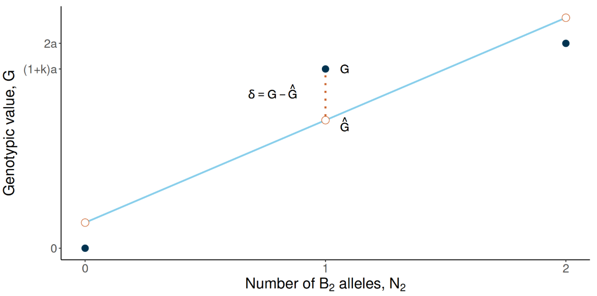

## Titulo

### Subtitulo ou texto

:::: {.columns .equal-blocks}

::: {.column width="50%"}

::: {.orangeblock}
::: {.block-title}
Alguma coisa...
:::
::: {.block-body}

- Textinho

$$
Equação: P = G + E + G \times E
$$

- Textinho

:::
:::

:::

::: {.column width="50%"}

::: {.blueblock}
::: {.block-title}
Alguma coisa...

:::
::: {.block-body}
- Textinho
- Textinho

:::
:::

:::

::::

---

## Titulo

- Ao clicar na imagem, ela abre ampliada no slide. Isso é feito usando o [.lightbox]{style="color: green; font-weight: bold;"}.

$$
G_{ij}=\hat{G}_{ij}+\delta_{ij}=\mu_G+\alpha_1N_1+\alpha_2N_2+\delta_{ij}
$$

{.lightbox fig-align="center" width="70%"}

---

## Titulo

:::: {.columns}

::: {.column width="45%"}

::: {.beamerbox}
::: {.img-box}

{.lightbox fig-align="center" width="85%"}

::: {.img-caption}
Figura: Legenda da figura.

:::
:::
:::

:::

::: {.column width="55%"}

::: {.beamerbox .bloco-direito}
- Textinho
- Textinho
- Textinho
:::

:::

::::

---

## Titulo

::: {style="font-size: 0.8em; line-height: 1.2;"}

- Slide básico/padrão
- Textinho
- Textinho
::: 

---

## Titulo

::: {.callout-note title="Note" style="width: 80%; margin: 0 auto;"}
::: {style="font-size: 0.8em; line-height: 1.2;"}
- Textinho
:::
:::

::: {.callout-tip title="Tip" style="width: 80%; margin: 0 auto;"}
::: {style="font-size: 0.8em; line-height: 1.2;"}
- Textinho
:::
:::

::: {.callout-warning title="Warning" style="width: 80%; margin: 0 auto;"}
::: {style="font-size: 0.8em; line-height: 1.2;"}
- Textinho
:::
:::

::: {.callout-important title="Important" style="width: 80%; margin: 0 auto;"}
::: {style="font-size: 0.8em; line-height: 1.2;"}
- Textinho
:::
:::

# Pausa dramática... {.slide-divisor background-color="#003350"}

---

## Titulo

::: {.slide-subtitle}
Referência bacana ou subtitulo
:::

::: {.orangeblock}
::: {.block-title}
Alguma coisa...
:::
::: {.block-body}
::: {.img-box-big}
{.img-big width="30%"}
:::
:::
:::

::: {.blueblock}
::: {.block-title}
Alguma coisa...
:::
::: {.block-body}
- Textinho
- Textinho
- Textinho
:::
:::

---

## Titulo

::: {.slide-subtitle}
Referência bacana ou subtitulo
:::

::: {.texto-intro-slide}
- Textinho geral
:::

:::: {.columns}

::: {.column width="43%"}

::: {.beamerbox}
::: {.img-box}

{.lightbox fig-align="center" width="85%"}

:::
:::

:::

::: {.column width="55%"}

::: {.beamerbox .bloco-direito .bloco-direito-menor}

- Textinho
- Textinho
- Textinho
:::

:::

::::

---

## Titulo

- Tabela usando LaTeX

$$
\begin{array}{ccc}
\hline
\textbf{Modelo} & \textbf{Parâmetro} & \textbf{Valor} \\
\hline
M1 & \alpha & 0.45 \\
M2 & \beta  & 0.72 \\
M3 & \gamma & 0.31 \\
\hline
\end{array}
$$

- Tabela usando Markdown

| Modelo | Parâmetro | Valor |
|:------:|:---------:|------:|
| M1 | $\alpha$ | 0.45 |
| M2 | $\beta$  | 0.72 |
| M3 | $\gamma$ | 0.31 |


# Códigos {.slide-divisor background-color="#003350"}

---

## Titulo

- Jeitinho padrão

```{r}
#| echo: true

set.seed(55)

dat = data.frame(
  geno = paste0("G", 1:5),
  y = rnorm(5, mean = 10, sd = 2)); dat
```

- Botão para mostrar código

```{r}
#| echo: true
#| code-fold: true
#| code-summary: "Mostrar código"
#| output: false

set.seed(55)

dat = data.frame(
  geno = paste0("G", 1:5),
  y = rnorm(5, mean = 10, sd = 2)); dat
```

---

## Referências (usando o BibTeX) {#slide-referencias}

::: {#refs}
:::
